# User Interface

The **CMSIS Solution** extension provides the Keil Studio GUI for project management and build tools with the
[CMSIS-Toolbox](https://open-cmsis-pack.github.io/cmsis-toolbox/). Combined with other Arm and third-party extensions,
it implements a powerful embedded development environment.

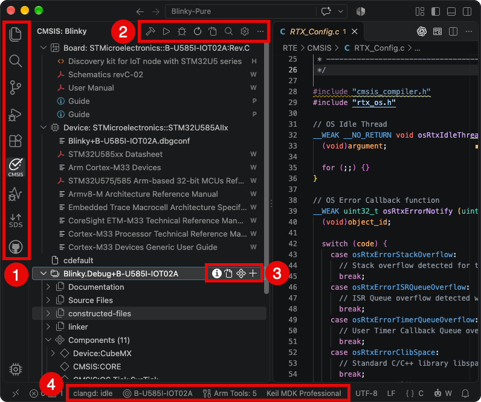

1. The [activity bar](#activity-bar) gives access to various views.
2. [Action buttons](#action-buttons) trigger specific commands.
3. Some [action icons](#main-area-icons) may appear depending on the file and context.
4. The [status bar](#status-bar) displays further information.

## Activity bar

| View | Description |
|:----:|:------------|
|  | [**Explorer** view](https://code.visualstudio.com/docs/getstarted/userinterface#_explorer-view) lists all local files. |
|  | **Search** view enables [search/replace](https://code.visualstudio.com/docs/editing/codebasics#_search-across-files) across all files. |
|  | [**Source Control** view](https://code.visualstudio.com/docs/sourcecontrol/overview) allows you to work with git. |
|  | [**Extensions** view](https://code.visualstudio.com/docs/configure/extensions/extension-marketplace) lets you work with VS Code extensions. |
|  | **Run and Debug** view switches the GUI to a dedicated [debug view](./debug.md#debugger-user-interface). |
|  | [**CMSIS** view](#cmsis-view) is the main view for working with CMSIS solution-based projects. |
| 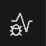 | [**Trace and Live** view](./debug.md#trace-and-live-view) shows trace and live data during debugging. |
| 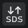 | **SDS** view allows capturing, replaying, inspecting, and validating synchronous data streams from embedded systems. |

!!! Note
    The ordering of the icons may be different in your VS Code environment. Depending on the installed extensions, you
    may also see additional view icons.

## CMSIS view

The CMSIS view  shows the content of the active projects included in the
solution. Each project contains configuration settings, source code files, build settings, and other project-specific
information. The main area of the **CMSIS** view shows:

- **Board** and **device** information and related documentation.
- **Groups and files**: Groups and user files that you add to the project and that you can edit
- **constructed-files**: Contains generated files such as the `RTE_Components.h` header file for each context
- **linker**: Contains a linker script file and a &lt;regions&gt;.h file (or other user-defined header files)
- **Components**: Shows the software components selected for the project with their source files, user code templates, and
  APIs. Click the files to open them in the editor. Click the book icon of a component to open the related documentation.
  If you are using a generator to configure your device or board, then a **Run Configuration Generator** option is available to start a
  generator session.
- **Layer Type** (if available): The software layers in the project with their source files, preconfigured software
  components, and configuration files

### No solution loaded

If no CMSIS solution is active in VS Code, the view shows the following:

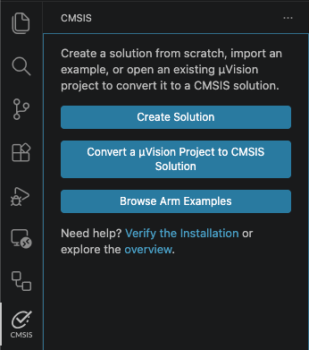

This allows you to:

- [Create a solution](./create_app.md#work-with-cmsis-solutions) from scratch.
- [Convert a µVision project](./importuv.md) to a CMSIS solution.
- [Browse Arm Examples](https://github.com/Arm-Examples) that show the usage of Arm technology on various platforms.

The links below the buttons take you to the documentation and the overview of the VS Code extension.

### Action Buttons

Once a CMSIS solution is loaded, the following action buttons are available:

| Action | Description |
|:------:|:------------|
|  | [**Build solution**](./build_run.md) calls the compiler toolchain and builds the solution. |
|  | [**Load & Run application**](./build_run.md#load-and-run) flashes the binary onto the target and starts the application. |
|  | [**Load & Debug application**](./debug.md) flashes the binary onto the target and starts a debug session. |
|  | [**Refresh Build and RTE Information**](#refresh-build-and-rte-information) reloads the CMSIS-Pack information, updates the cbuild and RTE files. |
|  | **Open csolution.yml file** opens the CMSIS solution YML file for editing. |
|  | [Search](#search-in-solution-sources) in the current solution configuration. |
|  | Open the [**Manage Solution**](./manage_settings.md) view to configure project and debug settings. |
|  | Show further [commands](#available-commands). |

#### Search in solution sources

Select **Search in Solution Sources** to open the VS Code **Search** view with a search scope limited to files that
belong to the current solution configuration. The scope includes the source files of the selected projects, source
files supplied by CMSIS-Packs, and the project YML files. Files that are excluded from the current configuration are
not searched.

#### Refresh Build and RTE Information

This button enables quick access to the command `Refresh (Reload Packs and Update RTE)` if the
`Auto Refresh On File Change` extension setting is disabled. In this case, the button shows that an update is required
by showing an additional exclamation mark: 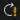.

### Main area icons

Depending on the file and the context, various icons may appear:

| Action | Description |
|:------:|:------------|
|  | IntelliSense is active for this cproject file. |
|  | Open the file. |
|  | Manage the software components of the cproject file. |
|  | Add groups or files to the cproject file. |

### Configure IntelliSense with clangd

The CMSIS Solution extension configures the [clangd language server](https://marketplace.visualstudio.com/items?itemName=llvm-vs-code-extensions.vscode-clangd)
for the active project. Running `cbuild setup` generates a
`compile_commands.json` compilation database and compiler macro headers in the
project output directory. When **Generate Clang Setup** is enabled in the CMSIS
Solution settings, the extension creates or updates the project `.clangd` file
to use this generated build information.

For solutions containing multiple projects, click **Activate Clangd
Information** next to the required `*.cproject.yml` file. The **Clangd
Information Active** icon identifies the project that currently provides
IntelliSense information.

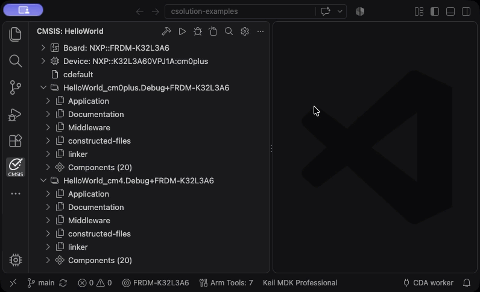

#### Compiler predefined macros

CMSIS-Toolbox generates separate predefined macro headers for C and C++ in the project output directory:

- `compile_macros_c.h` for C source and header files.
- `compile_macros_cxx.h` for C++ source and header files.

For non-CLANG toolchains, the generated `.clangd` configuration includes the
appropriate header according to the source file extension. Keeping the C and
C++ macro sets separate prevents C++-only compiler macros from affecting C
files. A native CLANG toolchain does not require these compatibility headers.

With the correct project active, clangd resolves compiler-specific conditional
code and provides completion, navigation, hover information, and diagnostics
that match the selected build context.

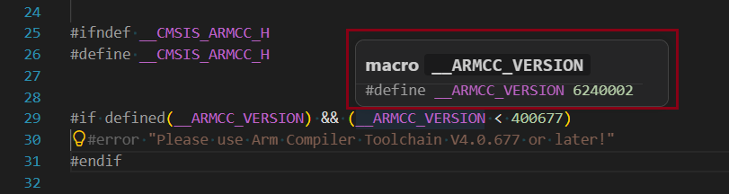

!!! Note
    The extension regenerates the project `.clangd` file when the solution
    context changes or when the VS Code window is reloaded. This configuration
    applies only to source and header files in the directory tree below the
    `.clangd` file. Files outside this tree do not use the project configuration
    and may therefore show different diagnostics. The file can contain absolute
    paths to generated build information and is not intended for persistent
    manual customization.

#### Troubleshoot IntelliSense

If editor diagnostics or completion do not match a successful build:

1. Check that **Generate Clang Setup** is enabled in the CMSIS Solution
  extension settings.
2. Run **Refresh (reload packs, update RTE)** and wait for solution conversion
  to complete.
3. Check that `compile_commands.json`, `compile_macros_c.h`, and
  `compile_macros_cxx.h` exist in the active context output directory.
4. Click **Activate Clangd Information** next to the project that contains the
  source file.
5. Open a C or C++ source or header file, then check the clangd status in the
  VS Code status bar. If indexing remains stale after regenerating the build
  information, run the `clangd: Restart language server` command from the
  Command Palette. If the problem persists, reload the VS Code window to
  regenerate `.clangd` and restart the extensions.

### Graphical previews

Files may have dedicated graphical previews:

- Files with [configuration wizard annotations](#configuration-wizard), such as header (`.h`) and debugger
  configuration files (`.dbgconf`).
- The [`vckpg-configuration.json`](#vcpkg-configuration-file) file.
- The [`*.csolution.yml`](./manage_settings.md#manage-solutions) file.
- The [`*.cproject.yml`](./create_app.md#software-components-view) file.
- The [`*.SWO.csv`](./debug.md#review-captured-trace-data) file.

#### Configuration Wizard

[Configuration Wizard annotations](https://open-cmsis-pack.github.io/Open-CMSIS-Pack-Spec/main/html/configWizard.html)
enable GUI-like elements in IDEs for configuration source files. This graphical approach makes it easier for users
to review and edit configuration settings as required by the application.

For files containing configuration wizard annotations, open the graphical view by pressing the **Open Preview** button
 in the top right corner of the file window.

The view will be opened next to the original source file. You can switch back pressing the **Show Source** button
.

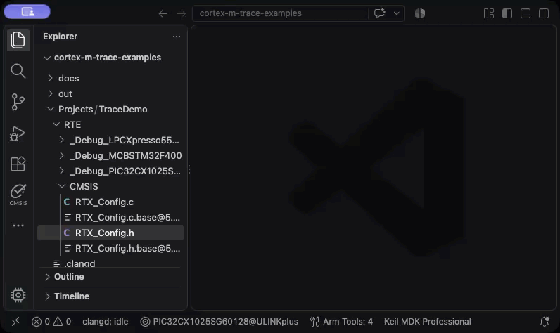

The configuration wizard view is error tolerant but notifies the user in case of malformed annotations:

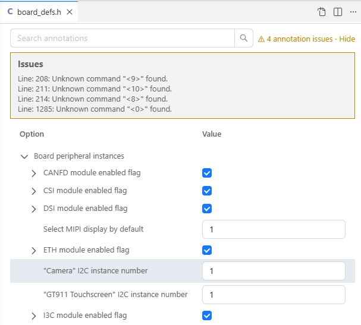

!!! Tip
    Use configuration wizard annotations for your own purposes (for example in header files). The built-in preview
    enables a graphical view to your files without additional effort.

#### Vcpkg configuration file

A `vcpkg-configuration.json` file specifies the development tools and versions required by a project. The Arm Tools
Environment Manager uses it to download and activate those tools, providing a consistent development environment. The
graphical preview makes it easier to detect optional tools and to select other tools versions.

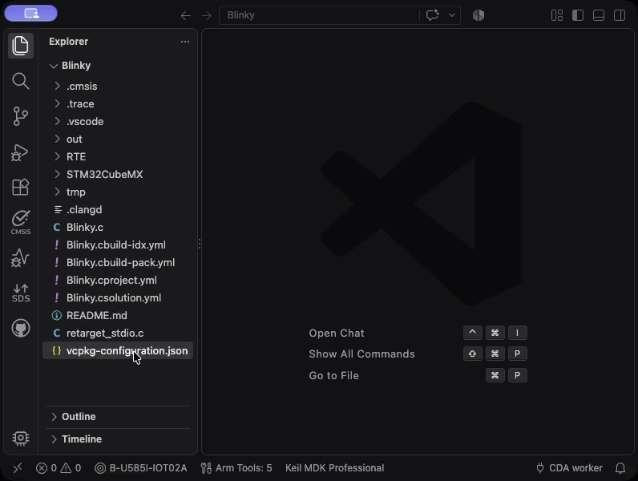

### Documentation Management

The document management system in Keil Studio gives versatile options to access and store solution-related
documentation. Locally stored documentation can be shared with other extensions, such as the
[CMSIS Developer Assistant](https://marketplace.visualstudio.com/items?itemName=Arm.cmsis-developer-assistant).

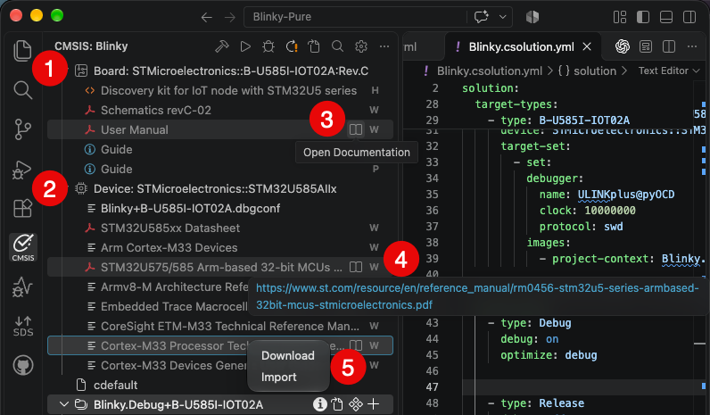

1. Board-related documentation is shown.
2. Device-related documentation is shown.
3. A fight-click on **Board/Device** enables you to add documentation.
4. A click on a book icon  opens the document.
5. Hovering over an [identification letter](#identification-letters) displays the document location.
6. A right-click on the document allows to download or import the document into the local document cache on the host
   machine (usually `~/.cmsis/docs`).

!!! Note
    Processor specific Arm architecture, core, debug and NPU manuals are automatically added to the list of device
    specific books.

#### Identification letters

| Letter | Meaning |
|--------|---------|
| H      | HTML-based documentation |
| P      | documentation contained in CMSIS-Pack |
| W      | Web-based documentation (non-HTML) |

!!! Note
    Icons in front of a documentation item may show additional information, such as file type (e.g. PDF).

## Status bar

The VS Code status bar displays information about the status of your development environment and the project:

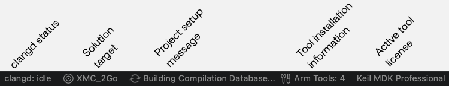

| Status bar item | Description |
|-----------------|-------------|
| clangd status   | Displays the status message of the **[clangd](#configure-intellisense-with-clangd)** extension that provides IntelliSense. |
| Solution target |You can inspect errors and warnings for the active csolution project when you move the cursor over the **Solution target** in the status bar. The indicator is red for errors and yellow for warnings. Click the indicator to open the **Output - CMSIS Solution** [panel](https://code.visualstudio.com/api/ux-guidelines/panel) and the [**Manage Solution**](./manage_settings.md) view. |
| cbuild setup message | **Building compilation database...** displays while the `compile_commands.json` file is created (during [cbuild setup](https://open-cmsis-pack.github.io/cmsis-toolbox/ReferenceApplications/#step-2-run-cbuild-setup)). |
| Tool installation information | The [**Arm Tools Environment Manager**](https://marketplace.visualstudio.com/items?itemName=Arm.environment-manager) extension downloads, installs, and manages software development tools. Move your mouse over **Arm Tools** to review the current list of installed tools. Click on **Arm Tools** to get more options. |
| Active tool license | If you are using licensed Arm tools, the **active license** displays. Click it to [manage](./installation.md#activating-keil-studio) the active license. |
| clangd indexing message | Shows the clangd indexing progress once a C, C++, or header file is opened in the editor. |

## Run and Debug view

Refer to the [Debugger user interface](./debug.md#debugger-user-interface) section for more information.

## Available commands

You can access commands to manage your solution and the related projects in the following ways:

- From the [**CMSIS** view](#cmsis-view).
- With right-click to the `*.csolution.yml` file in the [**Explorer**](https://code.visualstudio.com/docs/getstarted/userinterface#_explorer-view) view.
- With the [Command Palette](https://code.visualstudio.com/docs/getstarted/userinterface#_command-palette) that opens with Ctrl+Shift+P (Windows and Linux) or Cmd+Shift+P (macOS).

| Command | Description |
|:--------|:------------|
| Open Solution in Workspace...            | If your workspace contains several solutions, select the active solution to work with. |
| [Create Solution...](./create_app.md)    | Create a new *csolution project*.  |
| [Convert a µVision project to CMSIS solution...](./importuv.md) | Convert uvprojx files to *csolution project* format. |
| Close Solution                           | Close the current active solution. |
| [Search in Solution Sources](#search-in-solution-sources) | Search project sources, sources supplied by CMSIS packs, and project YML files that belong to the current solution configuration. |
| [Manage Solution Settings](./manage_settings.md) | Configure the target set (active target, projects, images, and debug adapter) for the solution. |
| [Configure Solution](./create_app.md#configure-a-solution) | Set a compiler and add software layers. |
| [Manage Software Components](./create_app.md#software-components-and-packs) | Review, add, or remove software components. |
| [Build solution](./build_run.md)         | Build the solution with the current target set. |
| Rebuild solution                         | Rebuild the solution with the current target set. |
| Clean all out and tmp directories        | Clean all out and tmp directories for the active solution. |
| Refresh (reload packs, update RTE)       | Reload information from all installed packs and run `cbuild setup update-rte`. |
| [Load & Run application](./build_run.md#load-and-run)       | Load the application to target and run it with active GDB server ([Debugger](./debug.md) can be attached). |
| [Load & Debug application](./debug.md)                      | Load the application to target and start the debugger. |
| Erase target device            | Erase the target device. |
| Load application to target     | Load the application to target. |
| Run application on target      | Run the current application in the target with active GDB server ([Debugger](./debug.md) can be attached). |
| Target Information             | Show information about debug adapter and target. |
| Focus on Solution View                   | Open the [CMSIS view](#cmsis-view). |

## Settings

The following is available via **Settings (Ctrl/Cmd ,) - Extensions - CMSIS Solution**.

### Auto Debug Launch

Create or update `launch.json` and `tasks.json` with the debug adapter configuration of the CMSIS solution project.
When disabled, the files `launch.json` and `tasks.json` are no longer modified. (Note: also available in [Manage Solution](./manage_settings.md) settings dialog).

### Auto Refresh On File Change

Automatically refresh build information when files used by the active solution change. When disabled, these file
changes mark the solution as needing refresh. Use Refresh Build Information to refresh manually. Changes committed via
webviews/dialogs will still automatically trigger refresh.

### Auto Show CMSIS View

Automatically shows the **CMSIS** view in the side bar when a CMSIS solution is loaded.

### Build Output Verbosity

Control verbosity of the build and setup console messages in the Terminal view.

Available options:

| Option         | Description|
|----------------|------------|
| quiet          | Show only errors or fatal conditions |
| normal         | Include build steps and warnings |
| build-commands | Show command invocations during build process |
| verbose        | Include command-line invocation |
| debug          | Include internal process steps |

### Download Packs

The CMSIS-Toolbox downloads required software packs using cpackget during setup and project build. This option enables the option `--packs` for `cbuild`.

### Environment Variables

Specify additional environment variables to be set for build, run, and terminals.

### Experimental Features

Enable experimental features.

### Generate Clang Setup

Automatically generate for the active solution context the required setup (`.clangd` file and `.vscode/settings.json`).
For AC6 compiler include pre-defined macros in the clangd file.

### Output Directory

Enter an output directory prefix for `outdir` and `tmpdir` and relocated build information files (experimental).

### Probe-ID (Modified in Workspace)

Specify the unique identifier of a debug probe to connect on your host computer (typically its serial number). Leave empty to connect o the first debug probe that matches the specified type. Try using Target Information with your debug adapter connected.
### Use Web Services

Use web services to obtain information about devices, boards, and examples. If enabled, information from the internet database and
installed packs is used. If disabled, only information from installed packs is used.